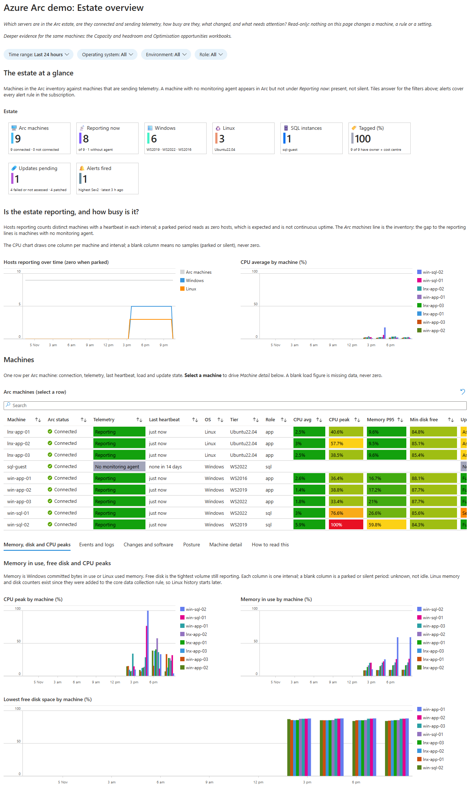
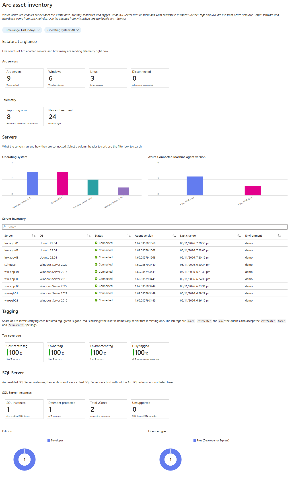
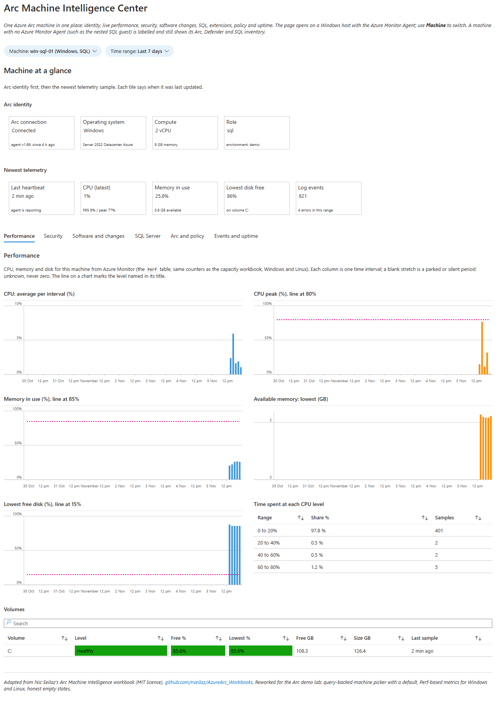
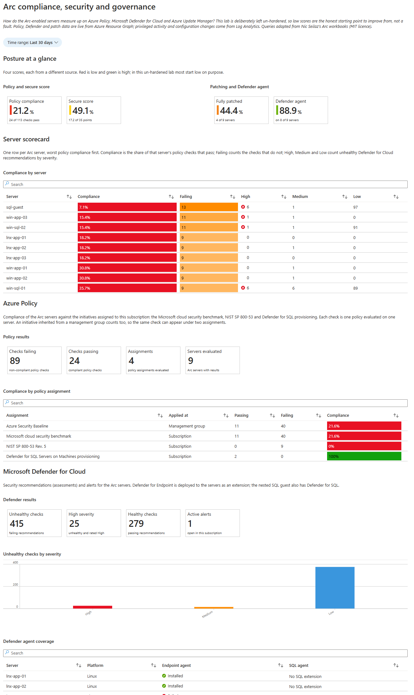
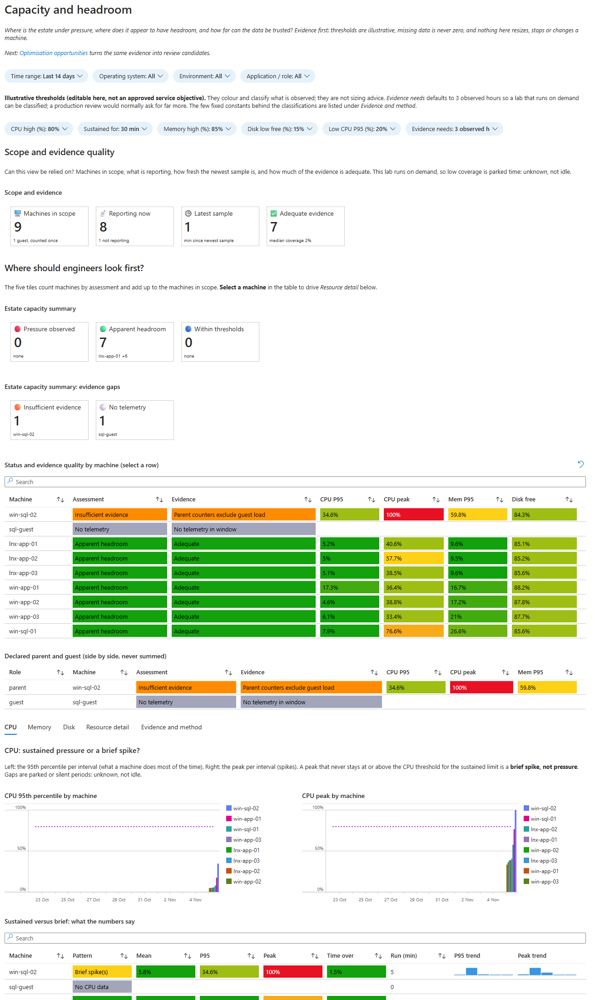
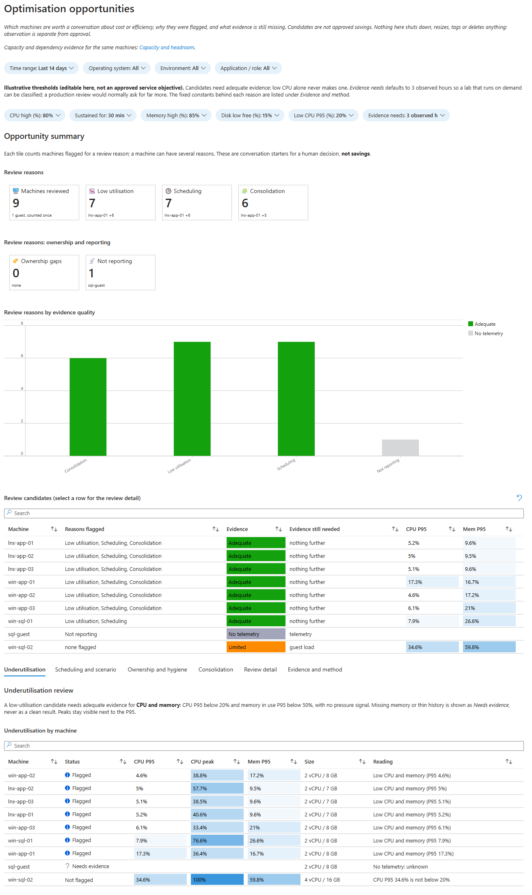

# Azure Arc demo

Show how Arc and Azure Monitor turn a Windows/Linux server estate into one
operational view: identity, telemetry, application activity, alerts and posture.
This repo covers the **Arc part**; the optional companion repo covers the SRE part.

## What you get

These screenshots come from a lab estate rebuilt from zero with this repo; each is one of the workbooks the build publishes, captioned with that workbook's own opening text.

**Estate overview.** Which servers are in the Arc estate, are they connected and sending telemetry, how busy are they, what changed, and what needs attention?

**Asset inventory.** Which Azure Arc-enabled servers does this estate have, are they connected and tagged, what SQL Server runs on them and what software is installed?

**Machine Intelligence Center.** One Azure Arc machine in one place: identity, live performance, security, software changes, SQL, extensions, policy and uptime.

**Compliance, security and governance.** How do the Arc-enabled servers measure up on Azure Policy, Microsoft Defender for Cloud and Azure Update Manager? In a deliberately un-hardened lab, low scores are the honest starting point, not a fault.

**Capacity and headroom.** Where is the estate under pressure, where does it appear to have headroom, and how far can the data be trusted? Evidence first: nothing here resizes, stops or changes a machine.

**Optimisation opportunities.** Which machines are worth a conversation about cost or efficiency, why they were flagged, and what evidence is still missing? Candidates are not approved savings.

## Quick start

Open the repo in your AI tool and ask for what you want, for example: "Read
AGENTS.md, then build the Arc demo in my subscription." The tool confirms your
tenant and subscription with you once, then plans and builds it. To drive the
scripts yourself, start with the
[ordered build wrapper](docs/runbook.md#build-everything-in-order-optional-wrapper)
(it plans first, then builds with `-Execute`) and the [runbook](docs/runbook.md).
The flow is: build, present, park and wake, remove.

## Present

Open **`.local/presenter-runsheet.md`** in Markdown preview and go top to bottom.
It contains the prepared lab's portal links and copyable KQL. No input cards,
subscription-ID substitution, customer skins or second presentation guide.

If that file is missing,
[generate it from the saved setup context](docs/runbook.md#prepare-the-local-presenter-guide).
The [tracked guide](docs/runsheet.md) is its source template.
Generation is offline; it does not activate the lab or certify current readiness.

The read-only Arc path is one 25-28 minute story, "the Monday-morning questions",
told in seven chapters that follow a single SQL database:
**what do we have (estate workbook) -> one server's evidence (Machine Intelligence
Center) -> safe and up to date (Compliance) -> the database (SQL under one view) ->
room for what is next (Capacity) -> where the money goes (Optimisation) -> what
happens at 2 a.m. (the alert rules)**, then a close that maps each customer question
to what they saw. The guide has cut lists for 20 and 15 minutes and a one-page stage
card.
The generated guide links to the optional SRE guide only when its local file
exists; live faults and the Review approval belong to that SRE half, where you
click Approve in the SRE portal. Leave the lab unchanged at the end.

## What the lab contains

- Five Windows Server 2016/2019/2022 and three Ubuntu 22.04 hosts by default.
- Azure-hosted Arc simulation using `MSFT_ARC_TEST=true`, not production
  on-premises infrastructure or blanket support validation.
- Arc identities, workspace, DCRs, workbooks, alerts, Change Tracking,
  VM Insights, Update Manager and security/governance configuration.
- Optional LOB sample, [real SQL workload](docs/sql-engine-workload.md),
  Azure-native VM, Container App and AKS. Source presence does not prove installation/health.
- Optional [nested SQL/Arc demo](docs/nested-sql-demo.md): proven scratch Windows
  guest build, SQL Developer, Arc connection and config-driven park/wake/remove.

SQL preparation is separate and optional; the base Azure-VM simulation keeps
Arc SQL/BPA off. The genuine nested guest has its own explicit extension step.
Linux dependency mapping is off.
Monitor readiness does not establish active antivirus, full EDR, patch completion
or application health. See [support boundaries](docs/lifecycle.md).

## Build, park, wake and remove

| Need | Reference |
|---|---|
| Build everything from zero, in order (plan first) | [Ordered build wrapper](docs/runbook.md#build-everything-in-order-optional-wrapper) |
| Build, prepare the presenter guide, or run an existing lab | [Runbook](docs/runbook.md) |
| Build, park, wake or remove the nested SQL guest | [Short nested SQL runbook](docs/nested-sql-demo.md) |
| Activate, park, remove, retry or understand readiness | [Lifecycle contract](docs/lifecycle.md) |
| Investigate a symptom | [Troubleshooting](docs/troubleshooting.md) |
| Costs and retained charges | [Cost reference](docs/cost.md) |
| Engineering, support and optional scenarios | [Documentation index](docs/README.md) |

| State | Cost stance | Retained | Transition |
|---|---|---|---|
| **Active** | Reprice the selected workloads | All resources | Normal operating state; `Ready` is its compatibility alias |
| **Hibernated** | Storage, monitoring and other retained charges remain | Disks, identities, Arc/Monitor configuration and data | Compute parked; NAT/PIP removed only when safe |
| **Removed** | Verify final charges and exceptions | Shared/tenant/soft-deleted items as documented | Both demo groups and named policies/budget removed |

Every script takes an explicit subscription and tenant.
Park the companion first; wake Arc to Ready before the companion.
Do not reset faults or rotate retained credentials to make a tour look healthy.
You do not need to reskin or redeploy anything to present.

## Develop

AI tools read [AGENTS.md](AGENTS.md) first. Use
[CONTRIBUTING.md](CONTRIBUTING.md) and [the module map](docs/module-map.md).
Private context and generated guides belong only in the gitignored `.local/`
folder; never store credentials or tokens there.

## Credits and licence

Inspired by [Nic Seilaz's](https://github.com/nseilaz) Arc/Monitor story.
The [vendored workbook library](workbooks/nseilaz/README.md) retains its upstream
attribution. MIT; see [LICENSE](LICENSE).
