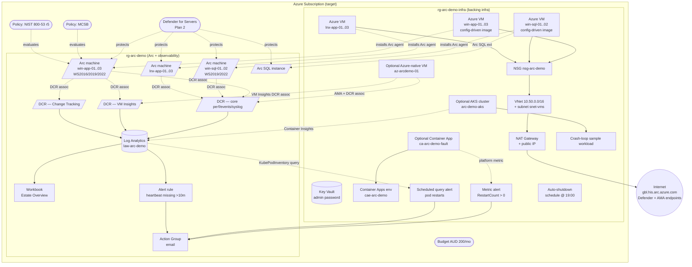

# Architecture

> What the deploy creates and how it's wired together.

## Topology

## Two resource groups, why

- **`rg-arc-demo`** — the things you'd have in a real customer environment (Arc machines, LAW, DCRs, workbook, alerts).
- **`rg-arc-demo-infra`** — the backing Azure VMs we use to *simulate* on-prem hosts. In a real engagement, these wouldn't exist — the Arc agent would be installed on actual on-prem servers.

Keeping them separate makes the demo flow read correctly in the portal (the customer never sees the "infra" RG; you only show them `rg-arc-demo`).

## Data flow

1. **Azure VMs** boot and the deploy script installs the **Connected Machine Agent** (`azcmagent`) with `MSFT_ARC_TEST=true` (officially supported for demo scenarios) so it registers a **Microsoft.HybridCompute/machines** resource in `rg-arc-demo`.
2. After Bicep creates the workspace and solutions, the deploy script waits for the required Log Analytics tables and then upserts the core, VM Insights, and Change Tracking DCRs.
3. The deploy script tags every Arc machine with OS tier, Monitor tier, ESU eligibility, inventory, Update Manager assessment, Defender, and Machine Configuration metadata.
4. For fleet entries with `supportsAzureMonitor=true`, the deploy script installs **AzureMonitorAgent** (or **AzureMonitorWindowsAgent**) and associates the core DCR.
5. For entries with `supportsVmInsights=true`, it associates the VM Insights DCR and installs **DependencyAgentWindows**. Pre-2016 Windows and unvalidated Linux tiers are excluded.
6. For entries with `supportsChangeTracking=true`, it associates the Change Tracking DCR and installs the Change Tracking extension.
7. **Defender for Servers Plan 2** is enabled at subscription scope; it auto-deploys the MDE extension and (for SQL hosts) the Defender for SQL extension.
8. **MCSB + NIST 800-53 r5** policy initiatives are assigned at subscription scope — their results power the regulatory compliance scorecard in Defender for Cloud (~12h to first populate).
9. The **Estate Overview workbook** pulls all of the above into one persona-ordered dashboard.
10. If `-DeployAzureVMs $true` is set, an extra Azure-native Windows VM is deployed in the infra resource group and monitored directly with AMA + post-Bicep DCR associations to the same workspace. It is not Arc-enabled, so it appears as a native Azure VM in Monitor.
11. If `-DeployContainerApps $true` is set, a tiny Container App is deployed in the infra resource group with `SIMULATE_CRASH=false` by default. Flipping that environment variable creates a crash-looping revision; the `RestartCount` platform metric alert emails the same Action Group.
12. If `-DeployAks $true` is set, a one-node AKS cluster is deployed in the infra resource group with Container Insights enabled against the same workspace. A sample workload can be put into `CrashLoopBackOff`, and a scheduled-query alert over `KubePodInventory` emails the same Action Group.

The fleet schema and legacy OS treatment are documented in
[`legacy-os-fleet.md`](legacy-os-fleet.md).

## Networking

- VMs sit in a single `/24` subnet behind an empty NSG (no inbound rules).
- A **NAT Gateway** provides outbound internet for the Arc agent's outbound-only API calls (required — Azure default outbound is being deprecated).
- The NAT GW is deleted by `Hibernate-ArcDemo.ps1` to save ~AUD 55/mo and recreated by `Activate-ArcDemo.ps1`.

## Identity

- VMs use system-assigned managed identities (for AMA on Linux, and SQL Arc extension).
- A service principal **`sp-arc-demo-onboard`** with the *Azure Connected Machine Onboarding* role on `rg-arc-demo` is created once and reused — its only job is for the Arc agent to register on first install.
- Key Vault stores the local-admin password (single secret `vm-admin-password`).

## Cost notes

See [`cost.md`](cost.md) for the breakdown by state (active / hibernated / removed).
